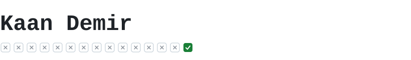

<!-- Profile README: github.com/wkaandemir -->

<picture>
  <source media="(prefers-color-scheme: dark)" srcset="assets/header-dark.svg">
  
</picture>

veri analizi yapıyorum, kullandığım araçların bir kısmını da kendim yazıyorum.\
yapay zekâ ajanlarıyla çok şey deniyorum. çoğu tutmuyor, tutanı burada ve X'te paylaşıyorum.

[E-posta](mailto:wkaandemir@gmail.com) · [LinkedIn](https://www.linkedin.com/in/wkaandemir/) · [X](https://x.com/wkaandemir)

### Tezgahta

- **Statence** — kod yazmadan analiz ve raporlama yapan masaüstü istatistik ürünü
- **RaGang** — 3D dünya küresi üzerinde topluluk platformu, [ragang.com](https://ragang.com)
- **PaperGo** — çok ajanlı akademik araştırma asistanı

### Açık projeler

| Proje | Nedir |
|---|---|
| [guvenlik-rehberi](https://github.com/wkaandemir/guvenlik-rehberi) | AppSec ve AI destekli geliştirme için pratik güvenlik dokümantasyonu |
| [branch-nexus](https://github.com/wkaandemir/branch-nexus) | Birden fazla git dalını ayrı worktree'lerde açıp tmux panelleriyle yöneten CLI (npm) |
| [ai-image-detector](https://github.com/wkaandemir/ai-image-detector) | AI ile üretilmiş görsel tespiti için CLIP ViT-B/16 + LoRA modeli |
